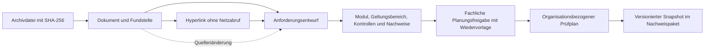

# Compliance-Einpflege für Forina

Die Archivdokumente und ihre Hyperlinks sind jetzt Eingaben eines versionierten Anforderungsregisters. Die Anwendung führt die Architekturbegriffe Forina/Fiona/Fiorona als denselben bestehenden Arbeitsraum **Forina** weiter.



## Erfasster Bestand

- 12 Archive, 503 Dateinachweise mit Hashes.
- 411 unterstützte Text- und Konfigurationsdateien vollständig ausgewertet, 3.673 normalisierte öffentliche Hyperlinks. Das ältere Suchfeld für Quellen arbeitet weiterhin mit seinen 360 begrenzten Textauszügen; die Compliance-Einpflege verwendet die vollständigen Texte.
- 92 weitere Einträge bleiben in der Abdeckung dokumentiert. Dazu gehören Dependency-/Build-Caches und nicht unterstützte Formate; sie werden nicht als Rechtsquellen interpretiert.
- 90 initiale Kandidaten: darunter 24 interne Guardrails und drei Software-Policies. Die übrigen Einträge sind Rechts-/Standardverweise und Einträge des ursprünglichen Regulierungskatalogs. Das ist keine vollständige Ermittlung sämtlicher rechtlicher Pflichten.

Der maschinenlesbare Bestand steht in `forina/data/compliance.json`; er enthält alle erfassten Dokumentbeschreibungen, Links, Fundstellen, Kandidaten, Abdeckung und einen deterministischen Paketdigest. Die Originaldateien bleiben unverändert. URLs werden normalisiert und dedupliziert, Fundstellen aus verschiedenen Archiven bleiben erhalten. Trackingparameter werden entfernt, Artikelanker bleiben erhalten. Interne Beispieladressen, IP-Adressen, URLs mit Zugangsdaten und erkannte Credential-Queryparameter werden nicht als öffentliche Quellenlinks übernommen.

Ein institutionell wirkender Hostname ist lediglich ein Herkunftshinweis. Es erfolgt weder ein Abruf noch eine Echtheits-, Aktualitäts- oder Rechtsprüfung des verlinkten Inhalts. Ein Link ist keine Bestätigung einer Pflicht, einer Zulassung oder einer institutionellen Zugehörigkeit.

## Zwei Einpflegewege

**Automatische Erfassung:** Der Import erkennt bekannte Rechtsbezeichnungen in Markdown-/Textdokumenten und Titeln sowie die vorhandenen strukturierten `laws.json`-/`guardrails.json`-Schemas. OPA-Dateien werden als Software-Policies katalogisiert und nicht ausgeführt. Ein Zitat enthält Dokumentkennung, Quellhash, Dokumentversionshash, Zeile/Spalte oder JSON-Pfad. Die originalen Guardrail-Anforderungstexte bleiben erhalten. Modulzuordnung, vorgeschlagene Kontrollmaßnahmen und Nachweisarten sind gesonderte Architekturvorschläge, keine wörtlich extrahierten gesetzlichen Pflichten.

**Fachliche Erfassung:** Unter „Dokumente und Hyperlinks mit Fundstellen“ lässt sich aus jedem erfassten Dokument oder Hyperlink eine eigene Anforderung anlegen. Damit sind auch Normen und Vertragswerke abbildbar, deren Namen der automatische Erkenner nicht kennt. Die Formulierung ist als `USER_AUTHORED_REQUIREMENT` gekennzeichnet; die ausgewählte Fundstelle wird erhalten. Ein Link wird dadurch nicht abgerufen oder zum Normnachweis erklärt.

Zusätzliche Texte lassen sich als Datei übernehmen oder einfügen und mit einer Quell-URL versehen. Vor dem Speichern zeigt eine Vorschau die erkannten Kandidaten und Hyperlinks. Vorschau und Commit müssen denselben Digest haben. Der gleiche Dokumenttitel bezeichnet dieselbe logische Quelle; eine erneute Einpflege erzeugt bei Änderungen neue betroffene Anforderungsrevisionen. Textinhalte werden unverändert gehasht, inklusive Zeilenumbrüchen. Manuell eingefügte Texte sind auf eine Million Zeichen begrenzt. Binäre PDF-/Office-Dateien werden nicht automatisch in Text umgewandelt.

## Architekturzuordnung

| Forina-Modul | Beispiel aus den Archivvorgaben | Vorgeschlagene Nachweise |
|---|---|---|
| Organisationsregister | G02–G04: Identität, Register und Aufsicht | Register-/LEI-Prüfung, Tätigkeits- und Zulassungsnachweis |
| Connector-Gateway | G09, G12, G20, G23: Minimalrechte, Zugangs- und Zieltrennung | Connector-Berechtigungen, Zielprüfung, Freigaben |
| Identität & Trust | G01, G05, G06, G24: Autorisierung, Trust Anchors, Zertifikatstypen | Challenge-, Signatur- und Statusprüfprotokolle |
| Infrastruktur | G07, G19: DNSSEC und Supply Chain | DNSSEC-, Build- und Abhängigkeitsnachweise |
| Datenschutz & Datenhaltung | G10, G11, G15, G18: Geheimnisse, Datenminimierung, Klassifizierung | Daten-, Lösch-, Logging- und Datenflusskonzepte |
| Nachweise & Provenienz | G13, G22: Gültigkeit, Widerruf, Rezertifizierung | Gültigkeits- und Statusänderungsprotokolle |
| Governance & Freigabe | G08, G17, G21: Zustimmung, Aufsicht, rechtliche Reichweite | Zustimmungsnachweis, fachlicher Prüfvermerk |
| Regulatory Policy Engine | G14, G16: Fehlerfälle und Geltungsbereich | Negativtests, Anwendbarkeitsbewertung |

Diese Zuordnung macht Anforderungen planbar. Sie implementiert nicht automatisch die jeweiligen Kontrollen, Registry-Connectoren oder Trust-Prüfer.

## Revision und fachliche Entscheidung

1. Quellenimport erzeugt `DRAFT`. Er gewährt keinen Zugang und bestätigt keine rechtliche Anwendbarkeit.
2. Die Bearbeitung konkretisiert Anforderung, Architekturmodul, Kontrollmaßnahmen, benötigte Nachweise, Rechtsräume und Sektoren. `*` bezeichnet ausdrücklich alle, niemals einen automatisch ermittelten Geltungsbereich. Jede Bearbeitung erzeugt einen neuen Entwurf.
3. Eine Planungsfreigabe benötigt vollständige Felder, Fundstelle, prüfende Person, fachliche Begründung, Quellenprüfvermerk und Wiedervorlagedatum. Ergebnis: `APPROVED_FOR_PLANNING`; alternativ `REJECTED`.
4. Der Prüfplan verwendet nur aktuelle freigegebene Revisionen, deren explizite Rechtsräume und Sektoren zum Organisationsdatensatz passen. EU-Mitgliedschaft wird nicht aus einem Ländercode abgeleitet. Eine Freigabe ist eine lokal dokumentierte Entscheidung; die Identität der prüfenden Person wird hier nicht authentifiziert.
5. Überfällige Wiedervorlagen werden als `REVIEW_OVERDUE` ausgewiesen und nicht mehr für die Planung verwendet. Das Datum ist ein UTC-Kalendertag und kein gesetzliches Inkrafttretensdatum.
6. Geänderte Quelltexte oder Quelladressen setzen betroffene Anforderungen auf eine neue Entwurfsrevision zurück. Fachlich bearbeitete Felder bleiben erhalten; die alte Freigabe wird nicht übernommen. Ein entfernter ausgewählter Link wird gekennzeichnet. Quellenlose automatisch erkannte Anforderungen werden `RETIRED`.

Optimistische Revisionskontrolle verhindert das Überschreiben neuerer Bearbeitungen; veraltete Requests erhalten HTTP 409. Unveränderte Reimporte erzeugen keine Revisionen. Quellenpaketversionen, Anforderungsrevisionen und Änderungsereignisse verbleiben in SQLite. Die Datenbank und ihre Historie sind lokal veränderbar und nicht extern beglaubigt oder manipulationssicher.

## Prüfplan und Export

`GET /api/organizations/{id}/plan` liefert unter `compliance_register` die verwendeten Anforderungen und ihre Revisionen, Kontrollmaßnahmen, offenen Nachweisarten, Quellen, Hyperlinks, Paketversionen und noch ausstehende Prüfungen. Die Nachweiserfüllung bleibt `NOT_ASSESSED`; eine lokale Freigabe darf nicht als bestandene Kontrolle ausgegeben werden.

Neue Nachweispakete verwenden Schema 2 und enthalten zusätzlich `compliance_register.json`. Die Komponenten-/Bundle-Hashes decken diesen Snapshot ab. Spätere Registeränderungen ändern bestehende Pakete nicht. Die Konsistenzprüfung unterstützt weiterhin Schema-1-Pakete. Signatur-, Identitäts-, Rechtskonformitäts- und Zugangsaussagen bleiben unbestätigt.

## API für die Einpflege

| Methode | Route | Funktion |
|---|---|---|
| GET | `/api/compliance` | Mengen, Status, Module und Paketversionen |
| POST | `/api/compliance/import` | Vorbereitetes Archivpaket idempotent einpflegen |
| POST | `/api/compliance/preview` | Text, Titel, optionale `source_url` als Vorschau auswerten |
| POST | `/api/compliance/documents` | Dieselbe Eingabe mit `preview_digest` und `expected_digest` speichern |
| GET | `/api/compliance/sources?q=…&page=1` | Dokumente und Hyperlinks mit Fundstellen paginiert anzeigen |
| GET / POST | `/api/compliance/rules` | Anforderungen anzeigen / eigene quellenbezogene Anforderung anlegen |
| GET | `/api/compliance/rules/{id}` | Aktuelle Revision, Quellen, Hyperlinks und Historie |
| POST | `/api/compliance/rules/{id}/edit` | Fachliche Felder mit `expected_revision` als neuen Entwurf speichern |
| POST | `/api/compliance/rules/{id}/review` | Lokale Freigabe/Ablehnung mit `expected_revision` dokumentieren |
| GET | `/api/compliance/packages/{id}/{digest}` | Gespeicherte Quellenpaketversion lesen |
| GET | `/api/compliance/events` | Letzte 100 lokale Änderungsereignisse |

## Reproduzieren und prüfen

```sh
python3 tools/import_compliance.py /workspace/forina-onboarding/inventory.json
python3 -m unittest discover -s tests -v
node --check forina/web/app.js
node --check forina/web/compliance.js
```

Der Import liest vollständige Originaldateien und vergleicht jeden erwarteten Dateihash mit dem bestehenden Quellenkatalog, bevor das portable Paket geschrieben wird. Geänderte oder fehlende Quellen führen zum Fehler, nicht zu einer stillen Übernahme. Danach erfolgt die Registereinpflege in der Oberfläche über „Archivbestand erneut einpflegen“. Ein Serverneustart allein überschreibt bestehende Registerstände nicht; neue Datenbanken erhalten automatisch den vorbereiteten Ausgangsbestand.

Optionaler echter Browsercheck mit bereits installiertem Playwright/Chromium:

```sh
python3 tools/browser_smoke.py
```

Der Browsercheck verwendet eine temporäre Datenbank, synthetische Angaben und blockiert externe Browseranfragen. Playwright/Chromium sind keine Abhängigkeiten der Anwendung.
