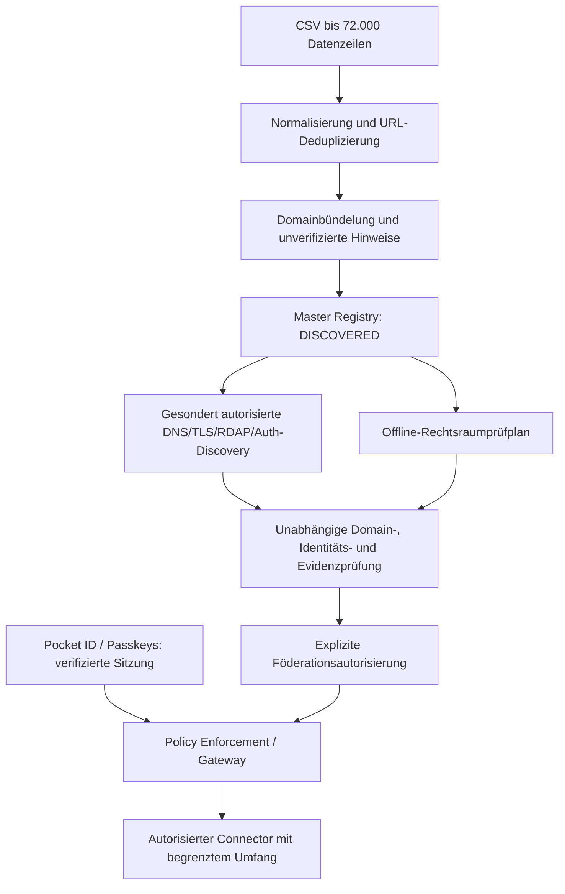

# FORINA: CSV-Master-Registry, Pocket ID und internationale Prüfplanung

Diese Ausbaustufe übernimmt das Nutzerkonzept „International Domain Trust & Compliance Automation“ vom 5. November 2026. Ziel sind bis zu 72.000 URLs, ein getrenntes technisches/regulatorisches Prüfprofil je URL, Pocket-ID-Anmeldung mit Passkeys und ausdrücklich autorisierte Portalverbindungen. Die vorhandene Implementierung bereitet den **Offline-Schritt** vor; eine reale Nutzer-CSV liegt noch nicht vor.



Die Schritte ab öffentlicher Onlineprüfung sind Zielarchitektur. Der CSV-Import führt weder DNS-/TLS-/DNSSEC-/RDAP-Abfragen noch Loginversuche, Portalregistrierungen, Domainänderungen oder Auth-Discovery aus. Die aktuelle Forward-Auth-Schnittstelle liefert immer HTTP 503 und keine Freigabe. Der Pocket-ID-Vertrag steht in [POCKET_ID_GATEWAY.md](POCKET_ID_GATEWAY.md).

## Länder- und institutionelle Hinweise

Die gewünschten Adaptionsräume sind DE, ES, IT, IE, CH, DK, FI, SE, PT, FR, BE, LU, EU und USA. NATO ist ein institutioneller Kontext und kein nationaler Rechtsraum.

| Kontext | Im Nutzerkonzept genannte Registry-/Aufsichtsbezüge (noch fachlich zu prüfen) |
|---|---|
| Deutschland | DENIC; DSGVO, BSI/NIS2, BaFin, DORA |
| Spanien | Dominios.es; AEPD, Banco de España, CNMV |
| Italien | Registro.it; Garante, Banca d’Italia, ACN |
| Irland | IE Domain Registry; DPC, Central Bank of Ireland |
| Schweiz | SWITCH; DSG, FINMA, NCSC |
| Dänemark | Punktum dk; Datatilsynet, Finanstilsynet |
| Finnland | Traficom; FIN-FSA, Datenschutz, NCSC-FI |
| Schweden | Internetstiftelsen; IMY, Finansinspektionen |
| Portugal | DNS.PT; CNPD, Banco de Portugal |
| Frankreich | AFNIC; CNIL, ACPR, AMF, ANSSI |
| Belgien | DNS Belgium; APD/GBA, NBB, FSMA |
| Luxemburg | DNS-LU; CSSF, CNPD |
| EU | EURid, europa.eu; eIDAS, AI Act, DORA, NIS2 |
| USA | .gov/.mil-Hinweise; CISA und sektorale Aufsicht |
| NATO | nato.int; institutionelle Nachweise und Teilnahmeautorisierung |

Eine TLD ist nur ein Hinweis. Eine `.com`-Domain kann zu einer Schweizer Bank gehören; `.bank` ist kein pauschaler US-Rechtsraum. Ein `nato.int`-Bezug bedeutet keine NATO-Partnerschaft. Registry- und Aufsichtsbezüge sind keine aktiven Connectoren oder validierten Zuständigkeiten.

## Import und Datenmodell

Die Oberfläche „CSV Master Registry“ und die CLI akzeptieren UTF-8-CSV, optional mit BOM. URL-Spalten werden anhand von Spaltennamen und Daten erkannt; bei Mehrdeutigkeit muss der Spaltenname ausdrücklich angegeben werden. Unterstützt werden übliche Komma-/Semikolon-/Tabulator-CSV sowie Dateien ohne Kopfzeile. Ein HTTP-Upload ist auf 32 MiB, ein Import auf 72.000 Datenzeilen begrenzt. Dateiformat-/Quotafehler verhindern die Übernahme des Batches; einzeln ungültige URLs werden gezählt und mit begrenzten, datensparsamen Fehlerhinweisen gemeldet.

Der Import normalisiert Schema, Host/IDNA und Standardport, entfernt Fragmente, bewahrt relevante Pfad-/Query-Unterschiede und dedupliziert nach normalisierter URL. Verschiedene URLs derselben Domain bleiben als Profile erhalten, werden aber zusätzlich in einer Domainansicht zusammengefasst. URLs mit Zugangsdaten, IP-/lokalen Zielen oder erkannten Credential-Queryparametern werden abgelehnt. Es gibt keine automatische HTTP-/HTTPS-Aufwertung aufgrund eines tatsächlich geprüften Zertifikats; bei schemalosen Angaben ist HTTPS nur die gewählte Normalisierungsannahme.

Jeder akzeptierte Eintrag beginnt mit `DISCOVERED`. DNS/TLS, Domainkontrolle, Organisationsidentität, regulatorische Evidenz und Authentifizierung sind `NOT_CHECKED`, tatsächliche Rechtsräume bleiben zunächst leer. `jurisdiction_hint` und `institution_hint` sind mit `HINT_ONLY_UNVERIFIED` markiert. Föderationsautorisierung und Zugang sind `false`, Signaturstatus `NOT_SIGNED`.

Die im Konzept vorgeschlagenen späteren Zustände `TECHNICALLY_VERIFIED`, `DOMAIN_CONTROL_VERIFIED`, `ORGANIZATION_VERIFIED`, `COMPLIANCE_EVIDENCE_VERIFIED`, `FEDERATION_AUTHORIZED` und `ACTIVE` werden durch den Import nicht gesetzt. Die zugrunde liegenden Dimensionen müssen unabhängig geprüft und widerrufbar bleiben; ein abgelaufener Nachweis darf nicht durch eine bloße Gesamtstatusnummer verdeckt werden. Bestehende signierte FTEP-Testnachweise bleiben von URL-Importprofilen getrennt.

Originaldateien werden nur gelesen, nicht geändert oder als ausführbare Programme verarbeitet. Importbericht, Quelldigest und Zählungen machen die Übernahme nachvollziehbar. Der Digest beschreibt die UTF-8-Textdarstellung, wie sie der Importer liest; Dateitransformationen/Encoding-Konvertierungen sind davon zu unterscheiden. Der Export enthält den normalisierten Prüfbestand und ist keine Kopie des Originals.

## Offline-Rechtsraumresolver

`POST /api/jurisdictions/plan` erhält ausdrücklich gewählte Rechtsräume und einen Sektor, optional institutionellen Kontext NATO. Er nutzt die bestehenden Archivkataloge, benennt Regelkandidaten und Quellen-/Aufsichtsverweise und zeigt gemeinsame Kandidaten als Überschneidung. Er gibt immer `compatibility: REQUIRES_REVIEW`, `legal_compatibility_verified: false` und `access_granted: false` zurück.

Niederlassung, Rolle, Tätigkeit, Zeitpunkt, Kundenkreis, Datenflüsse, Transfer-/Lokalisierungspflichten und mögliche Widersprüche benötigen eine eigenständige fachliche Bewertung. Gemeinsame Schlagwörter sind kein Nachweis rechtsraumübergreifender Kompatibilität. Die importierten Quellenverweise wurden nicht erneut online auf Aktualität geprüft.

## Pocket ID und Forward Auth

Pocket ID ist als OIDC-Identitätsanbieter für FORINA-Administratoren vorgesehen. Passkey-Anmeldung, Sitzungsverifikation, Rollen, Portalberechtigungen und Compliance-Evidenz sind unterschiedliche Prüfungen. Ein fremdes Portal akzeptiert einen FORINA-Login nur über einen tatsächlich unterstützten und autorisierten Integrationsweg.

Implementiert ist ein reiner Gateway-Planungsevaluator mit verweigernder Voreinstellung. Er kann deklarierte Voraussetzungen auf Vollständigkeit/Bindung/Gültigkeit prüfen; seine Eingaben sind keine verifizierten Zugangsdaten. Auch ein positives Planungsergebnis setzt `access_granted: false`. Eingehende Identitätsheader, bloße OIDC-Metadaten und selbst deklarierte Verifikation begründen keinen Zugang. Für einen echten Betrieb fehlen ein korrekt konfigurierter OIDC-Relying-Party-/Sessionverifier und die tatsächliche Zugriffsdurchsetzung.

## Verwendung

```sh
# Offline-Import; bestehende Quelldatei bleibt unverändert.
python3 -m forina.registry_client import examples/domain-registry-synthetic.csv
python3 -m forina.registry_client summary
python3 -m forina.registry_client export --output master-registry-neu.csv

# Explizite URL-Spalte bei unklarer CSV.
python3 -m forina.registry_client import meine-liste.csv --url-column Website
```

Die Beispieldatei enthält sieben synthetische Eingabezeilen mit sechs unterschiedlichen Ziel-URLs und einem Normalisierungsduplikat. Sie ist kein Beleg für schon geprüfte Domains oder tatsächliche institutionelle Beziehungen. Für Tests wird ein temporärer Speicher verwendet, nicht die produktive lokale Nutzerdatenbank.

## API

| Methode | Route | Zweck |
|---|---|---|
| POST | `/api/registry/import-csv?filename=…&url_column=…` | Raw UTF-8-CSV als `text/csv`; optionale URL-Spalte |
| GET | `/api/registry` | URL-/Domain-/Importzählungen |
| GET | `/api/registry/urls?q=…&page=1` | Paginierte URL-Profile |
| GET | `/api/registry/domains?q=…&page=1` | Zusammengefasste Domains |
| GET | `/api/registry/export.csv` | Normalisierter CSV-Prüfbestand |
| POST | `/api/jurisdictions/plan` | Fachlichen Prüfbedarf für explizite Rechtsräume ermitteln |
| GET | `/api/gateway/status` | Noch nicht konfigurierte Auth-/Gateway-Komponenten anzeigen |
| POST | `/api/gateway/plan` | Deklarierte Voraussetzungen als Plan evaluieren; keine Freigabe |
| GET | `/api/forward-auth` | Immer 503, bis echte Authentifizierung/Zugriffsdurchsetzung implementiert ist |

## Skalierung und offene Schritte

72.000 tägliche Prüfungen entsprächen rechnerisch 26,28 Millionen URL-Prüfungen pro Jahr bei 365 Tagen. Das ist eine Planungsgröße, keine durchgeführte Prüfung. Domainbündelung, Cache, risikobasierte Intervalle, Rate Limits und getrennte Online-Aufträge sind für eine spätere Prüfflotte nötig. Der jetzige Import plant oder startet keine Online-Prüfjobs.

Erst eine tatsächliche Nutzer-CSV liefert deren Master Registry. Online-Domain-/Auth-Discovery, Pocket-ID-Konfiguration, institutionelle Adapter, unabhängige Evidenzbewertung, produktive Signaturen und aktivierte Portalverbindungen bleiben spätere, konkret autorisierte Integrationen.
