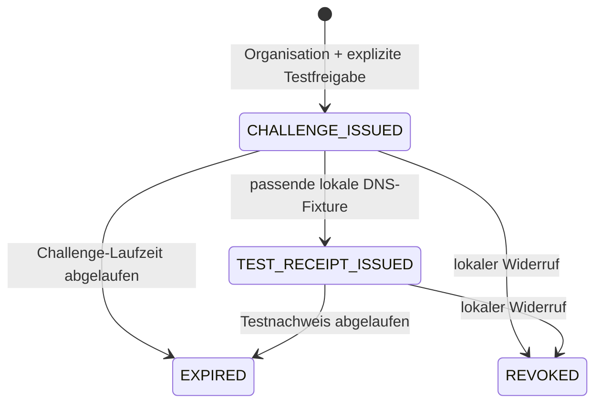

# FTEP-LOCAL-0.1: lokales Enrollment-Testprofil

Dieses implementierte Testprofil konkretisiert Phase II des [Concept Papers](FORINA_CONCEPT_V1.md). Es besteht aus einer lokalen Zustandsmaschine, einem DNS-Fixture-Test, einem Ed25519-signierten Testnachweis und einem davon getrennten lokalen Widerrufsstatus. Es ist ein Forina-eigenes Format, kein ACME-, JWS- oder OpenID-Federation-Standard.

## Ablauf und Zustände



Ein neuer Vorgang benötigt eine bereits erfasste Organisation, `test_consent: true` und eine Freigabereferenz mit mindestens acht Zeichen. Die Referenz ist eine lokale Testeingabe, keine unabhängig geprüfte Organisationsbefugnis.

Der Server erzeugt eine organisations- und domainbezogene Challenge mit eigenem zufälligen Token. Ihr DNS-Testname lautet `_forina-test-challenge.<domain>`. Die Laufzeit beträgt standardmäßig 300 Sekunden, explizit einstellbar zwischen 60 und 900 Sekunden. `txt_value` erscheint nur in der Erstellungsantwort; persistent gespeichert wird dessen SHA-256-Hash. Listen und erneute Einzelabfragen geben den Wert nicht zurück. Bei Verlust kann ein neuer Testvorgang begonnen und der alte widerrufen werden.

Die Simulation akzeptiert ausschließlich eine lokale Fixture aus `name` und `value`. Sie fragt weder DNS noch einen Resolver ab und verändert keine Domain. Ein passender Wert ergibt ausschließlich `SIMULATED_CONTROL_CONFIRMED`. Ablauf am exakten Endzeitpunkt, falsche Domain/Token, geänderte Organisationsdomain, Replay und Widerruf verhindern eine erfolgreiche Verwendung. Challenge-Verbrauch und Testnachweis werden in einer SQLite-Transaktion gespeichert; zwei konkurrierende Aufrufe können nicht zwei Nachweise für dieselbe Challenge ausstellen. Fehlgeschlagene Fixtures verbrauchen den gültigen Token nicht.

Jeder Testnachweis hat eine eigene Kennung, Organisations-/Domain-/Challenge-Bindung, Ausstellungszeit, höchstens eine Stunde Laufzeit und historische Hash-Verweise auf den Organisations- und Compliance-Snapshot. Diese Hashes bestätigen keine Erfüllung der offenen Nachweise und sind keine eigenständigen Registry-Abfragen. Quellenänderungen ändern frühere signierte Hash-Verweise nicht. Alle echten Vertrauensdimensionen bleiben ausdrücklich ungeprüft:

```json
{
  "purpose": "FORINA_LOCAL_TEST_ONLY",
  "domain_control": "SIMULATED_CONTROL_CONFIRMED",
  "real_domain_verified": false,
  "identity_verified": false,
  "compliance_verified": false,
  "federation_status": "TEST_ONLY_NOT_ENROLLED",
  "access_granted": false
}
```

Das Organisationsregister wird durch den Test nicht auf „verifiziert“ oder „aufgenommen“ gesetzt. Signierte FTEP-Testnachweise sind von den bisherigen unsignierten Schema-2-Prüfpaketen getrennt.

## Signaturformat und gepinnter Testschlüssel

Die Anwendung verwendet Python-Standardbibliothek und **OpenSSL 3 mit Ed25519-Unterstützung**. Im aktuellen Entwicklungsstand ist OpenSSL 3.5.7 erfolgreich geprüft. Bei der ersten Signatur-/Schlüsseloperation wird ein ausschließlich lokaler Testschlüssel in `.runtime/ftep-test-key.pem` erzeugt, privat mit Dateimodus 0600 abgelegt und nicht überschrieben. Nach Neustart bleibt derselbe Schlüssel erhalten. Schlüssel oder produktive Zugangsdaten werden nicht aus Dokumenten importiert.

Das Envelope enthält genau drei Felder:

```json
{
  "protected": {
    "typ": "FTEP-LOCAL-TEST",
    "alg": "Ed25519",
    "kid": "SHA-256 des lokalen öffentlichen Ed25519-Schlüssels in DER-Form",
    "version": 1
  },
  "payload": { "id": "...", "purpose": "FORINA_LOCAL_TEST_ONLY" },
  "signature": "Base64 der 64-Byte-Ed25519-Signatur"
}
```

Signiert werden die UTF-8-Bytes von `{"protected":...,"payload":...}` mit lexikografisch sortierten JSON-Schlüsseln, ohne zusätzliche Leerzeichen und ohne ASCII-Escaping von Unicode. Der Server konstruiert feste Claim-Typen; dies ist keine allgemeine interoperable JSON-Kanonisierungsnorm. Das Beispiel oben zeigt nur den Aufbau; ausgegebene Payloads enthalten alle Protokollfelder.

Der Verifier verwendet den beim lokalen Schlüsselmanager gepinnten öffentlichen Schlüssel. Weder ein mitgelieferter Schlüssel noch ein selbst gewählter `kid` oder Algorithmus wird als Vertrauensanker akzeptiert. Zusätzliche Envelope-Felder sind nicht zulässig. OpenSSL erhält die zu signierenden Bytes über private temporäre Dateien; private Schlüssel werden nicht in API-Antworten, Exporten, Logs oder Telemetrie ausgegeben.

Der Testschlüssel ist kein institutionell legitimierter Aussteller. Ein Verlust/Wechsel des lokalen Testschlüssels macht ältere Signaturen bei diesem Verifier unprüfbar; es gibt noch keine Schlüsselrotation oder externe Trust-Chain. SQLite und lokales Schlüsselverzeichnis sind kein manipulationssicherer Produktionsspeicher.

## Verifikation, Widerruf und Gültigkeit

Der Verifier unterscheidet:

| Feld | Aussage |
|---|---|
| `signature_valid` | Signatur gegenüber dem lokal gepinnten Testschlüssel korrekt |
| `time_valid` | Aktueller Zeitpunkt liegt im signierten Gültigkeitsintervall |
| `profile_valid` | Testzweck und ungeprüfte Vertrauensdimensionen entsprechen dem Testprofil |
| `status_known` | Exakter Nachweis ist im lokalen Vorgang gespeichert |
| `revoked` | Bekannter Vorgang ist lokal widerrufen |
| `usable_for_test` | Alle Testbedingungen erfüllt und nicht widerrufen |
| `trusted_for_federation` / `access_granted` | In diesem Profil immer `false` |

Ein Widerruf ändert den gespeicherten Status und das datensparsame lokale Ereignisprotokoll. Die historische Signatur bleibt gültig, `usable_for_test` wird jedoch `false`. Ein unbekannter Nachweis wird nicht als verwendbar behandelt, auch wenn seine Signatur kryptografisch korrekt ist. Eine externe, rein offline erfolgende Signaturprüfung kann keinen aktuellen Widerrufsstand bestätigen.

Neue Challenges sind neue Vorgänge; ein verbrauchter oder abgelaufener Token wird nicht erneuert oder reaktiviert. Die produktive automatische Renewal-/Monitoring-Engine des Concepts ist damit noch nicht implementiert.

## API

| Methode | Route | Eingabe/Ausgabe |
|---|---|---|
| POST | `/api/enrollments` | `organization_id`, `test_consent`, `authorization_reference`, optional `ttl_seconds`; neue Challenge mit einmaligem `txt_value` |
| GET | `/api/enrollments` | Testvorgänge ohne Tokenwerte |
| GET | `/api/enrollments/{id}` | Vorgang mit aktuellem Ablauf-/Widerrufsstatus |
| POST | `/api/enrollments/{id}/simulate` | `fixture: {name, value}`; signierter Testnachweis bei passender Fixture |
| GET | `/api/enrollments/{id}/receipt` | Signiertes Test-Envelope als JSON-Download |
| POST | `/api/enrollments/verify-test-receipt` | Exaktes Envelope; getrennte Prüfergebnisse |
| POST | `/api/enrollments/{id}/revoke` | `reason`; lokaler Widerruf |
| GET | `/api/enrollments/test-key` | Nur öffentlicher Testschlüssel, `kid` und Profil |

Die APIs bleiben Loopback-gebunden. Formulareingaben sind keine produktive Authentifizierung; eine produktive Federation Authorization ist nicht implementiert. Replays und bereits widerrufene/verbrauchte Challenges liefern HTTP 409, fehlerhafte Fixtures und unvollständige Testfreigaben HTTP 400.

## CLI und Tests

```sh
python3 -m forina.ftep_client
python3 -m unittest discover -s tests -v
python3 tools/browser_smoke.py
```

Der CLI-Client verwendet ausschließlich eine temporäre Datenbank, eine synthetische Organisation `example.org` und einen temporären Testschlüssel. Er zeigt Signatur und Verwendbarkeit vor/nach Widerruf und entfernt anschließend den Testzustand. Optional schreibt `--output <neue-datei.json>` einen öffentlichen Demonstrationsbundle aus Test-Envelope, öffentlichem Testschlüssel und abschließendem lokalem Status. Diese Datei ist ein Demonstrationsbundle, kein direktes API-Envelope. Ein anderer laufender Workbench-Verifier kennt diesen temporären Aussteller/Vorgang nicht und soll ihn nicht akzeptieren.

Für die Signaturprüfung in der laufenden Workbench verwende den dort unter „FTEP-Test“ erzeugten und heruntergeladenen Testnachweis. Der Browsercheck prüft diesen Ablauf einschließlich Download, erneuter Prüfung und Widerruf mit synthetischen Daten und blockierten externen Requests.

## Validierter Entwicklungsstand

Am 5. November 2026 bestanden 45 Tests der vollständigen Suite, darunter 17 fokussierte Enrollment-Tests und ein kompletter FTEP-HTTP-Test. Der echte Browserablauf bestand mit Compliance-Einpflege, FTEP-Test-Challenge, Download, Signaturprüfung und Widerruf; JavaScript-Fehler wurden nicht beobachtet. Alle verwendeten Organisations-/DNS-Daten waren synthetisch. Das ersetzt keine unabhängige Produktions-Sicherheitsprüfung.

## Verbleibende Zielkomponenten

Live-DNS/DNSSEC/TLS/RDAP, unabhängige Organisations-/LEI-/vLEI-/eIDAS-Prüfung, echte regulatorische Evidenzbewertung, extern verankerte Schlüssel, autorisierte Zugangsrechte, öffentliche/geschützte Library-of-State-Bereiche und produktives Renewal bleiben eigenständige spätere Arbeitspakete. Die vollständige Zuordnung steht in [IMPLEMENTATION_MAP.md](IMPLEMENTATION_MAP.md).
