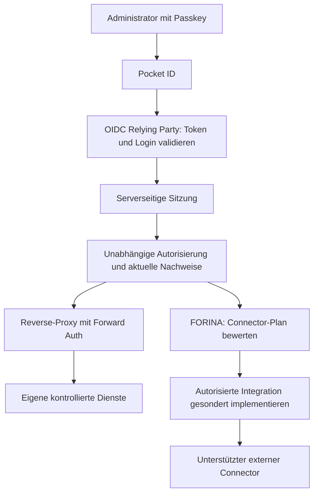

# Pocket ID, Passkeys und FORINA Gateway

Dieses Dokument konkretisiert die Anmelde- und Autorisierungsschicht des [FORINA-Konzepts](FORINA_CONCEPT_V1.md). Der aktuelle Stand besteht aus einem **lokalen, rein beratenden Policy-Modell** in [`forina/gateway_policy.py`](../forina/gateway_policy.py). Es gibt noch keinen eingerichteten Pocket-ID-Provider, OIDC-Client, geprüften Login, produktiven Reverse-Proxy oder Zugriff auf externe Portale.

`evaluate_gateway(context)` kann ausschließlich `DENY` oder `ELIGIBLE_FOR_AUTHORIZED_CONNECTOR_PLAN` zurückgeben. Auch der zweite Wert bedeutet nur: Die angegebenen Planungsbedingungen sind vollständig beschrieben. Jede Antwort enthält `access_granted: false`, `enforcement_implemented: false` und `input_authenticity_verified: false`. Das Ergebnis darf niemals als erfolgreiche Forward-Auth-Antwort oder als Zugriffstoken verwendet werden. Selbst vollständig erfundene Eingaben können lediglich einen als solchen gekennzeichneten Plan beschreiben.

## Geplante Vertrauensgrenzen



Pocket ID authentifiziert einen Benutzer. Domainkontrolle, juristische Organisationsidentität, regulatorische Evidenz, Föderationseinwilligung und Zugriff auf eine konkrete Ressource benötigen getrennte Nachweise. Ein Passkey-Login stellt diese Nachweise nicht her. Der existierende lokale FTEP-Testnachweis ist ebenfalls keine dieser produktiven Bestätigungen.

Für die spätere OIDC-Anbindung muss eine serverseitige Relying Party den Code-Flow einschließlich PKCE, `state` und `nonce` prüfen. Erwarteter Issuer und Audience stammen aus geschützter Serverkonfiguration. Signatur, erlaubter Algorithmus, Schlüssel, Gültigkeit und die Bindung an den begonnenen Login müssen überprüft werden. Ungeprüfte oder fehlende Authentifizierungsmethoden dürfen nicht als Passkey-Anmeldung ausgegeben werden. Die konkrete Pocket-ID-Version und deren tatsächlich unterstützte Claims sind vor der Implementierung gegen die offizielle Dokumentation zu prüfen.

Erst dieser Verifier darf eine serverseitige Sitzung erzeugen. Browserseitig angelieferte Header, Cookies oder JSON-Felder mit Namen wie `verified`, `subject` oder `authentication_method` sind kein Verifikationsnachweis. Für das tatsächliche Session-Cookie sind unter anderem `Secure`, `HttpOnly`, eine passende `SameSite`-Richtlinie, begrenzte Laufzeit und Widerruf erforderlich; CSRF-Schutz bleibt eine eigene Aufgabe.

Der Reverse-Proxy muss alle eingehenden Identitätsheader entfernen und darf nur selbst erzeugte, serverseitig geprüfte Identitätsinformationen an eigene Dienste weitergeben. Der Forward-Auth-Dienst muss ausschließlich über einen geschützten internen Kanal angesprochen werden. Geschützte Anwendungen dürfen keinen direkt erreichbaren Zugang besitzen, der die Proxy-Prüfung umgeht. Fehler, unbekannte Schlüssel, abgelaufene Sitzungen, Widerruf oder nicht erreichbare Verifier müssen den Zugriff verweigern. Eine ungeschützte lokale Vorschau ist noch kein produktives Gateway.

Für fremde Portale reicht ein eigener Forward-Auth-Proxy nicht aus. Der Betreiber muss eine geeignete Föderation oder API unterstützen und die Integration ausdrücklich genehmigt haben. Discovery von OIDC-, OAuth- oder SAML-Metadaten beschreibt höchstens eine technische Fähigkeit. Sie bestätigt weder Partnerschaft noch Organisationsidentität oder Berechtigung. Aus einer URL-Liste folgen keine Loginversuche, Kontoerstellungen, DNS-Änderungen oder aktiven Portalverbindungen.

## Vertrag des lokalen Planungsmodells

`evaluate_gateway(context, *, now=None)` ist eine reine Funktion ohne Netzwerkzugriff und ohne Veränderung der Eingabe. `now` ist ausschließlich eine interne Testuhr als ganzzahliger Unix-Zeitstempel; ein späterer HTTP-Client darf sie nicht bestimmen. Ohne Testuhr wird die aktuelle Systemzeit verwendet. Am Ablaufzeitpunkt selbst ist ein Nachweis bereits ungültig.

Die Eingabe benötigt genau diese Felder; unbekannte und fehlende Felder werden abgelehnt:

| Objekt | Felder und Bedeutung |
|---|---|
| Wurzel | `profile`, `policy`, `session`, `target`, `authorization`, `evidence` |
| `profile` | Genau `FORINA_GATEWAY_PLAN_V1` |
| `policy` | `issuer`: HTTPS-Issuer; `audience`: erwartete Audience; `allowed_resources`: explizit konfigurierte Ressourcen |
| `session` | `verification_profile`, `verified`, `issuer`, `audience`, `subject`, `issued_at`, `expires_at`, `revoked`, `authentication_method` |
| `target` | `kind`: `OWN_SERVICE` oder `EXTERNAL_PORTAL`; `resource`; `required_scopes` |
| `authorization` | `verification_profile`, `verified`, `subject`, `resource`, `scopes`, `approval_reference`, `expires_at`, `revoked` |
| `evidence` für eigene Dienste | Leeres Objekt `{}`; die unabhängige Ressourcenautorisierung bleibt erforderlich |
| `evidence` für externe Portale | Genau `domain_control`, `organization_identity`, `regulatory_evidence`, `federation_consent`, `jurisdiction_compatibility` |
| Jeder externe Nachweis | `verification_profile`, `verified`, `reference`, `expires_at`, `revoked` |

`session.verification_profile` muss `OIDC_VERIFIER_OUTPUT` lauten, `authorization.verification_profile` muss `INDEPENDENT_AUTHORIZATION` lauten und jeder externe Nachweis benötigt `INDEPENDENT_EVIDENCE`. `verified` muss ausdrücklich der boolesche Wert `true` sein, `revoked` ausdrücklich `false`. Zahlen wie `1` ersetzen keinen booleschen Wert. Ablaufzeiten sind Ganzzahlen; fehlender oder unbekannter Widerrufsstatus verhindert die Planfreigabe.

Die Sitzung benötigt `authentication_method: "PASSKEY"`. Issuer und Audience müssen exakt zur Policy passen. Die Autorisierung muss an dasselbe Subjekt und dieselbe Zielressource gebunden sein und sämtliche erforderlichen Scopes enthalten. Die Zielressource muss in `allowed_resources` stehen. Ressourcen und Scopes sind begrenzte, eindeutige Listen interner Kennungen, keine beliebigen URLs. Ein freier Referenztext ist im Modell nur eine Referenz, keine Echtheitsprüfung des referenzierten Dokuments.

Die vollständige Beispielstruktur liegt als synthetischer Testfall in [`tests/test_gateway_policy.py`](../tests/test_gateway_policy.py). Eine mögliche Antwort auf einen vollständigen Plan lautet:

```json
{
  "profile": "FORINA_GATEWAY_PLAN_V1",
  "decision": "ELIGIBLE_FOR_AUTHORIZED_CONNECTOR_PLAN",
  "reasons": ["ALL_DECLARED_PLANNING_PRECONDITIONS_PRESENT"],
  "eligible_for_plan": true,
  "access_granted": false,
  "enforcement_implemented": false,
  "input_authenticity_verified": false,
  "scope": "OFFLINE_PLANNING_ONLY"
}
```

Der Kontext darf später ausschließlich aus serverseitiger Policy, einer validierten Sitzung und unabhängig geprüften Nachweisen zusammengestellt werden. Ein öffentliches API darf keine vom Client gelieferte `policy` oder angeblich verifizierte `session` an ein durchsetzendes Gateway weiterreichen. Der aktuelle Evaluator authentifiziert die Herkunft dieser Objekte ausdrücklich nicht und enthält noch keine persistente Nachweisprüfung oder Policy Enforcement Point.

## Rechtsräume und unabhängige Freigaben

`jurisdiction_compatibility` bedeutet einen dokumentierten, fallbezogenen Prüfentscheid, einschließlich beteiligter Rechtsträger, Tätigkeiten, Datenflüsse und einschlägiger Anforderungen. Eine TLD ist nur ein Klassifizierungshinweis. EU- oder NATO-Bezüge sind keine automatischen nationalen Zulassungen; NATO ist kein Rechtsraum wie ein Staat. Ungeklärte Anwendbarkeit oder ein ungeklärter Drittlandtransfer kann im Modell nicht als bestätigter Nachweis gelten.

Vor einer echten Aktivierung muss der Nachweisadapter sämtliche externen Evidenzen an die konkrete Organisation, Domain, Zielressource, genehmigten Handlungen und gültige Policy-Version binden. Der einfache Referenzvertrag dieses Offline-Prototyps ersetzt diese Prüfung nicht. Sperrung einer Sitzung, eines Nachweises oder einer Ressourcenfreigabe muss unabhängig von einem früher ausgestellten Trust Record wirksam werden.

## Nächste Implementierungsschritte

1. Eigene Dienste und konkrete, ausdrücklich genehmigte externe Connectoren inventarisieren; serverseitige Ressourcen und Scopes festlegen.
2. Pocket ID und OIDC Relying Party in einer kontrollierten Testumgebung mit synthetischen Konten einrichten. Produktive Schlüssel und vertrauliche Daten bleiben außerhalb des Repositorys und der Entwicklungsagenten.
3. Den OIDC-Verifier, Session-Speicher, Nachweisadapter und unabhängige Autorisierung implementieren; Token-, Header-, Replay-, Ablauf- und Widerrufsgrenzen separat testen.
4. Reverse-Proxy und tatsächlichen Forward-Auth-Endpunkt erst mit dieser Verifikation verbinden; direkten Anwendungszugriff sowie vom Client gesetzte Identitätsheader nachweislich ausschließen.
5. Externe Connectoren erst nach dokumentierter Betreiberautorisierung, geklärter Rechtsraumprüfung und unabhängigen Integrations- und Sicherheitstests aktivieren.

Die lokale Policy-Prüfung lässt sich ohne Pocket ID, Zugangsdaten oder Netzwerkanfragen ausführen:

```sh
python3 -m unittest discover -s tests -p test_gateway_policy.py -v
```
